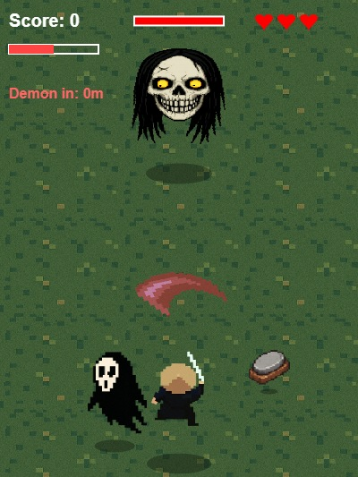
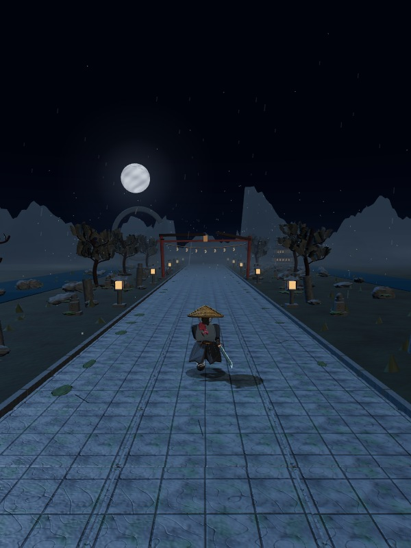

# Ichi Runer

Two versions of Ichi in one repository.

| V1 - Ichi Original | V2 - Ichi 2 |
| :---: | :---: |
|  |  |
| Boss encounter in the pixel-art original | A regular run through Moonlit Shrine |

| Folder | Game |
| --- | --- |
| `v1/` | Ichi Original, the original pixel-art HTML and Canvas game |
| `v2/` | Ichi 2, the full Three.js 3D samurai runner |

## Run

Install Node.js 18 or later, then run `npm start` from this folder. Open `http://127.0.0.1:8794/` and choose a version. No package installation or build is required. All runtime resources are local.

The launcher serves the games on the local computer. You can also host the static game files with a static web server. Browser storage belongs to each deployment and is not included in this repository.

## Controls

In Ichi Original, A/D or the left/right arrows move, and Space/W/S attacks. The game also supports mouse and touch input.

In Ichi 2, A/D changes lanes, Space double-jumps, S slides, J or click releases a sword wave, and holding Shift boosts. E opens schools and upgrades, Esc pauses, and M toggles audio. With Lightning equipped, double-jump and press Shift again to phase while holding the key and spending energy. The game supports touch controls and key rebinding.

## Versions

Ichi Original keeps the original pixel-art gameplay. Its resource URLs have been replaced with bundled files and optional platform SDK integration has been removed for standalone play.

Ichi 2 includes the complete 3D game with five schools, persistent local progression, multiple worlds and bosses. It is the full game rather than the separate tutorial prototype.

## Credits

Three.js r180 uses the MIT license included at `v2/assets/three-LICENSE.txt`. Cormorant Garamond and Manrope use the SIL Open Font License included beside the font files. The sprites and audio come from the original game. Third-party notices remain with their resources.

Run `npm test` to check the local server's request boundaries.
